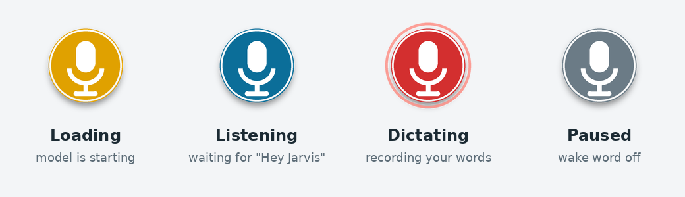
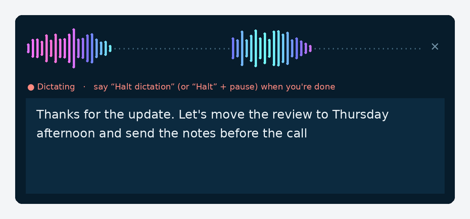
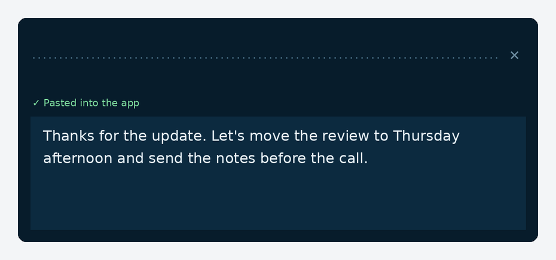

# JARVIS — Just A Resident Voice Interaction System

Local voice dictation and read-aloud for Windows. Everything runs on your own machine: no audio or text is sent anywhere.

- **Dictate anywhere.** Say **"Hey Jarvis"**, talk, then say **"Halt dictation"**. The text is copied to the clipboard and pasted into whatever app has focus.
- **Read anything aloud.** Select text in any app and press **Ctrl+Alt+R** to hear it.







*These images are rendered from the app's own drawing code and colours; the on-screen font is Segoe UI.*

## Contents

- [Requirements](#requirements)
- [Quick start](#quick-start)
- [Using it](#using-it)
- [Configuration](#configuration)
- [Speech-to-text engines](#speech-to-text-engines)
- [Text-to-speech engines and voices](#text-to-speech-engines-and-voices)
- [Start with Windows](#start-with-windows)
- [Project files](#project-files)
- [Troubleshooting](#troubleshooting)
- [Privacy](#privacy)
- [Limitations](#limitations)
- [Third-party components](#third-party-components)

## Requirements

- Windows 10 or 11
- Python 3 (developed and run on 3.13)
- A microphone
- About 1.5 GB of disk space for the virtual environment, the speech model (~600 MB) and one or more voices

## Quick start

In PowerShell, from the project folder:

```powershell
.\setup.ps1
.\Jarvis-v1\Scripts\python.exe app.py
```

`setup.ps1` creates the `Jarvis-v1` virtual environment, installs `requirements.txt`, and downloads the speech model and the Piper voice set in `config.py`. It is safe to re-run. If PowerShell blocks the script, use `powershell -ExecutionPolicy Bypass -File .\setup.ps1`.

`app.py` re-launches itself in the background, so you can close the console. Quit from the tray icon or the mic's right-click menu.

<details>
<summary>The same setup, step by step</summary>

```powershell
python -m venv Jarvis-v1
.\Jarvis-v1\Scripts\activate
pip install -r requirements.txt
python download_model.py        # speech-to-text model, ~600 MB
python download_voice.py        # the Piper voice set as PIPER_MODEL_PATH in config.py
python app.py
```

</details>

Other ways to start it:

| Command | What it does |
|---|---|
| `python app.py` | Starts detached in the background; output goes to `dictation.log` |
| `python app.py --foreground` | Stays attached to the console, for debugging |
| Double-click `start_dictation.bat` | Starts in the background with no console window |

## Using it

### Dictation

| To | Do this |
|---|---|
| Start | Say **"Hey Jarvis"** (or just "Jarvis"), click the floating mic or the tray icon, or press **Ctrl+Alt+Space** |
| Stop | Say **"Halt dictation"**, say **"Halt"** and pause, click the mic again, press **Ctrl+Alt+Space** again, or click the **✕** on the card |
| Pause wake-word listening | Tray menu or the mic's right-click menu → Pause. Click and hotkey still work |
| Move the mic | Drag it |

While you dictate, a card shows a live waveform (its colour follows your pitch) and your words as they are recognised. When you stop, the text is copied to the clipboard and pasted into the focused app, and your previous clipboard content is put back. Set `AUTO_PASTE = False` to only copy.

The mic colour shows the state: amber while the model loads, blue when listening for the wake word, red while dictating, grey when paused.

### Read aloud

| Shortcut | What it does |
|---|---|
| **Ctrl+Alt+R** | Reads the selected text aloud. Never writes anything to disk |
| **Ctrl+Alt+Shift+S** | Reads it aloud and also saves a WAV to `tts_output\` (Piper engine only) |

Press either shortcut again while it is speaking to stop.

## Configuration

All settings live in `config.py`. Edit the file and restart the app.

| Setting | Default | What it controls |
|---|---|---|
| `WAKE_ENABLED`, `WAKE_REGEX` | on, "Hey Jarvis" + common mishearings | The phrase that starts dictation |
| `STOP_REGEX` | "Halt dictation" | The phrase that ends dictation |
| `SOFT_STOP_ENABLED`, `SOFT_STOP_PAUSE` | on, 0.8 s | Ending with a bare "Halt" followed by a pause |
| `HOTKEY_ENABLED`, `HOTKEY_MODIFIERS`, `HOTKEY_KEY` | on, Ctrl+Alt+Space | The dictation shortcut |
| `AUTO_PASTE`, `RESTORE_CLIPBOARD` | on, on | Paste into the focused app, then restore the old clipboard |
| `ENGINE` | `"nemotron"` | Speech-to-text engine (see below) |
| `NUM_THREADS` | 4 | CPU threads for the speech model |
| `INPUT_DEVICE` | `None` (Windows default) | Part of a microphone name to pin, e.g. `"Microphone Array"` |
| `TTS_ENGINE` | `"piper"` | Text-to-speech engine (see below) |
| `PIPER_MODEL_PATH` | `en_GB-alba-medium` | Which Piper voice to use |
| `TTS_VOICE`, `TTS_RATE` | `"Zira"`, 0 | Voice name and speed for the `"sapi"` / `"onecore"` engines |
| `TTS_HOTKEY_*`, `TTS_SAVE_HOTKEY_*` | Ctrl+Alt+R, Ctrl+Alt+Shift+S | The read-aloud shortcuts |
| `TTS_SAVE_DIR` | `tts_output\` | Where saved readings go |
| `SHOW_CARD`, `SHOW_FLOATING_MIC` | on, on | Show or hide the card and the mic button |
| `WAKE_TRACE` | on | Log wake-word timing and near misses to `wake_trace.log` (no sentences) |
| `WAKE_DEBUG` | off | Log what was heard instead of the wake phrase. Stores your words in plain text; debugging only |

## Speech-to-text engines

Set `ENGINE` in `config.py`. All three share the same interface, so switching is a one-line change plus a restart. If the chosen engine fails to load, the app falls back to `"whisper"` and prints why.

| `ENGINE` | Model | Notes |
|---|---|---|
| `"nemotron"` (default) | NVIDIA Nemotron 0.6B streaming English, sherpa-onnx int8 export | Downloaded by `download_model.py`. Streaming, so the wake and stop phrases work |
| `"nemotron_local"` | The same model as Microsoft/Olive-exported ONNX graphs (`genai_config.json`, `encoder.onnx`, `decoder.onnx`, `joint.onnx`, `vocab.txt`) | You supply the model folder (`NEMOTRON_LOCAL_MODEL_DIR`); there is no download script. Runs on `onnxruntime` directly. fp32, so heavier on CPU; outputs cased, punctuated text |
| `"whisper"` | faster-whisper `small.en` | Optional (`pip install faster-whisper`). Transcribes only when you stop, so no live text and no voice triggers |

## Text-to-speech engines and voices

Set `TTS_ENGINE` in `config.py`.

| `TTS_ENGINE` | Voices | Notes |
|---|---|---|
| `"piper"` (default) | Open-source neural voices | Needs `piper-tts` (in `requirements.txt`) and a downloaded voice. The only engine that can save audio |
| `"sapi"` | Classic Windows voices (David, Zira, Mark) | Built into Windows, nothing to install. The only engine `TTS_RATE` applies to |
| `"onecore"` | Windows "Natural" voices (Aria, Guy, Jenny, ...) | Needs a voice added under Settings → Time & Language → Speech; not available on every PC |

### Piper voices

`config.py` has six voices pre-written; uncomment the `PIPER_MODEL_PATH` line for the one you want.

| Voice | Description |
|---|---|
| `en_GB-alba-medium` | British (default) |
| `en_GB-cori-medium` | British |
| `en_US-amy-medium` | US, soft and conversational |
| `en_US-lessac-high` | US, narrator style, highest quality |
| `en_US-kristin-medium` | US |
| `en_US-hfc_female-medium` | US, non-commercial / research licence |

```powershell
python download_voice.py                                        # the voice set in config.py
python download_voice.py en_US-amy-medium en_GB-cori-medium     # any others, by name
python list_voices.py --piper                                   # what is downloaded
python test_piper_voices.py                                     # hear the same sample in every voice
```

Voices are downloaded from [rhasspy/piper-voices](https://huggingface.co/rhasspy/piper-voices) on Hugging Face. Each voice has its own licence; check its model card before using it for anything beyond personal use.

## Start with Windows

```powershell
.\install_startup.ps1       # adds a shortcut to your Startup folder (no admin needed)
.\uninstall_startup.ps1     # removes it
```

## Project files

### Application

| File | Purpose |
|---|---|
| `app.py` | Entry point. Runs the microphone loop, the dictation state machine (wake word → dictating → stop), the global hotkeys, clipboard/paste delivery and the read-aloud worker |
| `config.py` | Every setting: trigger phrases, hotkeys, engines, model paths, audio and UI options |
| `engines.py` | The speech-to-text engines (`nemotron`, `nemotron_local`, `whisper`) behind one interface, plus `load_engine()` |
| `textutil.py` | Pure text and audio helpers: finding the wake and stop phrases, cleaning the transcript, and the level/pitch analysis that drives the waveform |
| `tts.py` | Read-aloud: grabs the current selection, then speaks it with the chosen engine, optionally saving a WAV |
| `ui.py` | The dictation card (waveform and live text) and the floating mic button, built with tkinter |
| `tray.py` | The system-tray icon and its menu |
| `micicon.py` | Draws the anti-aliased mic icon used by the button and the tray |
| `layered.py` | Windows per-pixel-alpha window helper that gives the floating mic smooth edges |

### Setup and downloads

| File | Purpose |
|---|---|
| `setup.ps1` | One-shot setup: creates `Jarvis-v1`, installs requirements, runs both download scripts |
| `requirements.txt` | Python dependencies, pinned to the versions the app was run with |
| `download_model.py` | Downloads and unpacks the speech-to-text model into `models\` |
| `download_voice.py` | Downloads Piper voices into `models\piper\` |
| `start_dictation.bat` | Double-click launcher with no console window |
| `install_startup.ps1` | Adds a Startup-folder shortcut so the app runs at sign-in |
| `uninstall_startup.ps1` | Removes that shortcut |

### Text-to-speech helpers

| File | Purpose |
|---|---|
| `speak.ps1` | Speaks text from stdin with the classic Windows (SAPI5) voices; called by `tts.py` |
| `speak_onecore.ps1` | Speaks text from stdin with the Windows "Natural" (OneCore) voices; called by `tts.py` |
| `list_voices.py` | Lists installed Windows voices (`--onecore` for Natural voices) or downloaded Piper voices (`--piper`) |
| `test_piper_voices.py` | Reads one sample text in every downloaded Piper voice and saves a WAV of each, to compare by ear |

### Microphone tools

| File | Purpose |
|---|---|
| `list_devices.py` | Lists the microphones Windows exposes, for setting `INPUT_DEVICE` |
| `mic_test.py` | Records two seconds from each microphone and reports which ones actually hear you |

### Documentation

| File | Purpose |
|---|---|
| `README.md` | This file |
| `backlog.md` | Ideas not yet built, and the status of shipped features |
| `docs/images/` | The images used in this README |
| `.gitignore` | Keeps the virtual environment, caches, models, logs and saved audio out of git |

### Created at run time (not in git)

| Path | Contents |
|---|---|
| `Jarvis-v1\` | The virtual environment |
| `models\` | The speech model and Piper voices |
| `tts_output\` | WAV files saved with Ctrl+Alt+Shift+S |
| `dictation.log` | Messages and errors when running without a console |
| `wake_trace.log` | Wake-word timing, near misses and audio-backlog warnings |

## Troubleshooting

**"Hey Jarvis" does nothing.** Check the microphone first; a muted or wrong mic sends silence.

1. Quit the app (tray icon → Quit), run `python mic_test.py` and keep talking while it tests each input.
2. Each mic is reported as OK, weak or SILENT. The one marked `*` is the Windows default, which the app uses when `INPUT_DEVICE = None`.
3. If your usual mic is SILENT, set `INPUT_DEVICE` in `config.py` to part of the name of one that shows OK. Ignore driver entries with huge peak values or "could not open" errors.
4. Restart the app. `dictation.log` records which mic was chosen and warns if no sound arrives for 30 seconds.

**The mic works but the wake word is missed.** Look at `wake_trace.log`: a `NEAR MISS` line shows what the model heard instead of "Jarvis", and you can add that spelling to `WAKE_REGEX`. For more detail set `WAKE_DEBUG = True`, restart, and read the `[heard-idle]` lines in `dictation.log`; turn it off afterwards.

**The wake word is slow.** `BACKLOG` lines in `wake_trace.log` mean the CPU is falling behind real time. Raise `NUM_THREADS`.

**Read-aloud says "Nothing selected".** The focused app ignored the simulated Ctrl+C. This happens with apps running as administrator.

## Privacy

The microphone is monitored continuously for the wake phrase, but all audio is processed on-device and is never stored or sent anywhere. Text-to-speech is local too. The only network access is the one-time model and voice downloads. Use Pause in the tray menu to stop listening for the wake phrase.

## Limitations

- **English only.** The Nemotron English model is the only streaming engine.
- **Windows only.** The hotkeys, window styling, startup script and auto-paste rely on Windows APIs.
- **A muted microphone means no dictation.** If your headset syncs a call app's mute at hardware level, Windows receives no audio. Dictate with a different microphone (`INPUT_DEVICE`) or turn off mute sync in the headset software.
- **Other people can trigger it.** With speakers instead of a headset, the wake phrase spoken by someone in a call could start dictation. Pause wake-word listening during calls.
- **Wake-word accuracy depends on recognition.** "Hey Jarvis" is detected from the live transcript, not by a dedicated wake-word model, so it can be misheard or occasionally false-triggered.
- **A bare "Halt" needs a pause.** It only stops dictation when it is the last word and you then stay quiet. A deliberate trailing "halt" in your text is dropped; say "Halt dictation" instead.
- **Slight delay.** Words appear about half a second behind your speech.
- **Elevated apps.** Auto-paste and read-aloud cannot send keystrokes into apps running as administrator.
- **Hotkeys match "these modifiers are held", not "only these".** Two shortcuts on the same key, where one's modifiers are a subset of the other's, would both fire. Use different letters.
- **Global keyboard hook.** The shortcuts use a system-wide key hook, which security tools can occasionally flag. Disable with `HOTKEY_ENABLED`, `TTS_HOTKEY_ENABLED` and `TTS_SAVE_HOTKEY_ENABLED` set to `False`.
- **Plain text only.** No spoken punctuation commands ("new line", "comma") or editing commands. Casing and punctuation come from the speech model.
- **First start is slow.** Loading the model takes a few seconds; the mic is amber until it is ready.

## Third-party components

Nothing below is bundled in this repository; each is installed or downloaded during setup and keeps its own licence.

| Component | Used for | Licence |
|---|---|---|
| [sherpa-onnx](https://github.com/k2-fsa/sherpa-onnx) | Streaming speech recognition runtime and the packaged model | Apache-2.0 (runtime) |
| NVIDIA Nemotron Speech Streaming En 0.6B | The speech model | See NVIDIA's model licence |
| [Piper](https://github.com/OHF-Voice/piper1-gpl) (`piper-tts`) | Neural text-to-speech | GPL-3.0 |
| [Piper voices](https://huggingface.co/rhasspy/piper-voices) | Voice models | Varies per voice |
| onnxruntime, sounddevice, numpy, pynput, pyperclip, pystray, Pillow | Runtime libraries | See each project |
